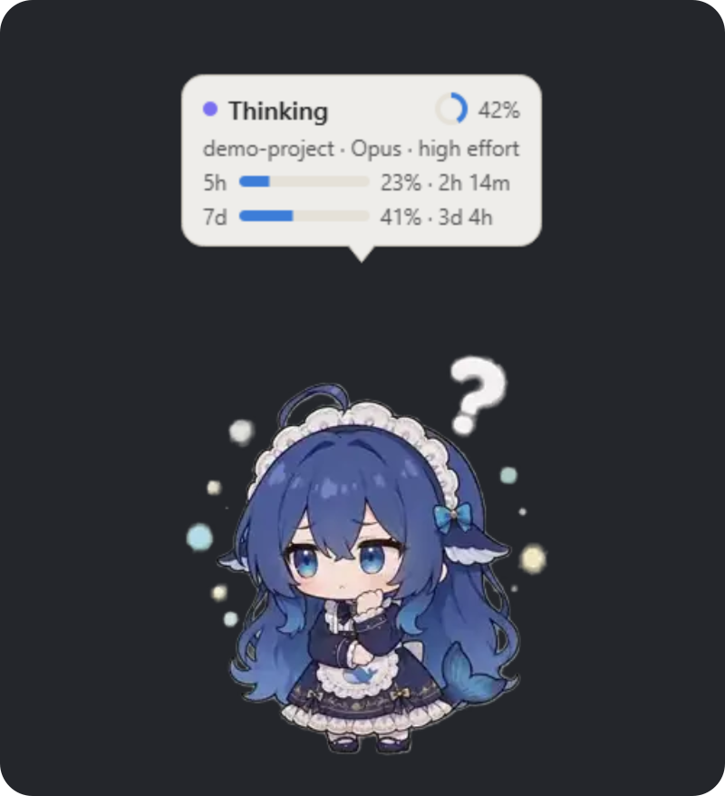

# cc-companion 🐾

**住在桌面上的小伙伴，在你用 Claude Code 工作时陪着你。**

[English](README_EN.md) · [代码授权：MIT](LICENSE) · [角色素材授权](companion/assets/character/LICENSE.txt)

 

她待在屏幕一角、浮在其他窗口之上，告诉你 Claude Code 正在做什么：思考、改文件、跑命令、等你确认、完成。看着它工作完全免费，不消耗任何 token。如果你愿意，她还能开口说话：用自己的话回应你的一天、和你聊天，并且一天天地记住你。

*自带角色为鲸尾女仆，动画来自 [PC2005-cloud/dsh-pet](https://github.com/PC2005-cloud/dsh-pet)（素材仅限非商业使用，见[致谢与授权](#致谢与授权)）。*

## 她能做什么

- **显示 Claude Code 的状态：**思考、读取与查找、编辑文件、执行命令、委派子 Agent、等你确认、完成、出错和压缩上下文。
- **状态气泡：**项目、模型、推理强度、子 Agent、任务进度、上下文占用，以及 5 小时和 7 天的用量。
- **和你互动：**拖到任何地方、摸摸头、戳一戳、碰碰尾巴。
- **开口说话（可选）：**用你自己的 Anthropic API Key，她会在值得一提的时刻说上一句、在你找她聊天时回答，每晚还会睡觉：写日记、整理对你的了解，偶尔做个梦。

## 她的动作

**Claude Code 工作时**

<table>
<tr>
<td align="center"> 待机</td>
<td align="center"> 思考 · 压缩上下文</td>
<td align="center"> 编辑文件 · 委派子 Agent</td>
<td align="center"> 执行命令</td>
</tr>
<tr>
<td align="center"> 读取与查找 · 等你确认</td>
<td align="center"> 完成</td>
<td align="center"> 出错</td>
<td></td>
</tr>
</table>

**和她互动时**

<table>
<tr>
<td align="center"> 摸摸头（或双击）</td>
<td align="center"> 戳一戳</td>
<td align="center"> 碰碰尾巴</td>
<td align="center"> 拖动她，再放手</td>
</tr>
</table>

**没事发生时**

<table>
<tr>
<td align="center"> 伸个懒腰</td>
<td align="center"> 打个哈欠</td>
<td align="center"> 偷吃 token</td>
<td></td>
</tr>
</table>

开启她的声音后，其中一些动作也代表她的心情：开心（尾巴）、得意（完成）、担心（戳一戳）、困了（打哈欠）、好奇（伸懒腰）。预览为 40% 大小、每秒 8 帧；在桌面上她是原尺寸、每秒 24 帧。

## 开始使用（Windows 10 / 11）

1. **解压** `cc-companion-<版本>-windows-x64.zip` 到任意位置。最好放在路径里没有空格的文件夹，比如 `C:\Apps\cc-companion`（原因见[状态栏](#状态栏)）。
2. **双击 `cc-companion.exe`。**程序没有数字签名，Windows 可能提示“Windows 已保护你的电脑”：点**更多信息**，再点**仍要运行**。
3. **她出现了：**在屏幕右下角，同时她的头像会出现在系统托盘（任务栏右侧的通知区域，可能收在 **^** 箭头里）。
4. **连接 Claude Code：**右键托盘图标，选择**Connect to Claude Code…**并确认。之后每个新的 Claude Code 会话都会唤醒她，终端和桌面应用都可以。
5. **可选，让她开口说话：**右键托盘图标，选择**Set API key…**，粘贴在 [console.anthropic.com](https://console.anthropic.com) 申请的 Key。然后右键她，选择 **Persona → On**。

就这样。如果她没在运行，下一个 Claude Code 会话或下一条消息会自动把她叫起来。

## 怎么用

右键她或她的托盘图标打开菜单，左键托盘图标可以显示或隐藏她。改动立即生效，并会被记住。（菜单目前为英文。）

| 菜单 | 作用 |
| --- | --- |
| Show her / Hide her | （托盘）显示或隐藏她 |
| Set API key… | （托盘）保存她说话所需的 Key |
| Connect to Claude Code | （托盘）在 Claude Code 设置里添加或移除她的 hooks |
| Size | 小、中、大 |
| Bubble | 总是显示、只在需要你时显示（等待、出错、完成），或不显示 |
| Idle moves | 没事发生时，她伸懒腰、打哈欠、玩耍的频率 |
| Persona | 她的声音和记忆，见下文 |
| Reduce motion | 保持不动，气泡照常更新 |
| Show subagent count | 显示正在工作的子 Agent 数 |
| Sounds | Claude 完成或出错时播放提示音 |
| Hide until all sessions end | 现在隐藏，所有 Claude Code 会话结束后退出 |
| Quit | 隐藏她，没有会话在运行时退出；新会话会让她回来 |

### 她的声音和记忆（Persona）

默认关闭，需要 API Key（见上面第 5 步）。

| Persona 菜单 | 作用 |
| --- | --- |
| Off / On / Quiet | On：说话并表现心情。Quiet：只有心情动作，不说话也不花钱 |
| Today: … | 她今天说了几句话、花了多少钱 |
| Talk to her… | 在她身边打开一个小聊天框，她在气泡里回答，聊天框保留今天的对话 |
| What she knows… | 她对你的了解。不对的可以归档，她就不再使用 |
| Private today | 今天的事都不会被记住（到早上 5 点为止） |
| No pause | 一有动静就可以说话，句子之间不再间隔（花费可能更多） |
| Limit | 普通（每小时 30 句、每天 0.5 美元）、不限，或自定每天几句 |
| Chattiness | 安静、普通、话多：她有多少次开口的机会 |
| Open her folder | 打开她的身份、日记、记忆和设置，都是普通文件 |

**她知道你在不在。**你离开键盘时，她不会自言自语；你回来时，她可能会打个招呼，告诉你离开期间完成了什么。下午、傍晚和深夜到来时她也会察觉。她说话说到一半时摸她，她会说完再回应你。

**她的一天在早上 5 点结束。**一天结束后，等你离开半小时，她就会睡觉：写一篇日记、更新对你的了解、慢慢改写一点“自己正在成为的样子”，偶尔还会做梦，第二天早上可能会告诉你。

**把她变成你的。**她默认叫汐（小汐），说简体中文。打开她的文件夹，编辑 `identity.md`，就能改她的名字、性格、语言，以及她怎么称呼你。

### 花费

- **看 Claude Code 工作是免费的。**只用 Claude Code 的 hooks，不花任何 token。
- **她说话用你的 API Key**，模型是最便宜的 Claude Haiku：每句话或每次聊天回复约 0.0001 到 0.0003 美元，每晚睡觉约零点几美分。普通的一天大约一两美分。
- 默认每小时最多 30 句、每天最多 0.5 美元，超过后只做心情动作。可以在 **Persona → Limit** 修改，菜单里随时能看到今天的花费。

## 状态栏

在终端里使用 Claude Code 时，它还会在输入框下方加一行状态栏，比如 `Opus high | ctx 12% | 5h 23% 2h14m`，并为气泡提供上下文和用量信息。桌面应用不运行状态栏，所以那里气泡显示的内容会少一些。如果你已有自己的状态栏，连接时会保留你的。

状态栏需要文件夹路径里没有空格或特殊符号。如果有、又没有可用的短路径，她会在没有状态栏的情况下连接；换个文件夹后重新连接即可。

## 隐私

- **观察只在你的电脑上进行。**她只在本机（127.0.0.1）上监听，只保留事件名、工具名、计数、项目文件夹名这类标签。你的提示词、代码、文件和 Claude 的回复一到就被丢弃，从不保存。
- **她说话时**，只把这些标签（Claude Code 在做什么、时间、计数、项目文件夹名）和你在聊天框里打给她的话发给 Anthropic。她看不到你的代码、提示词或 Claude 的回复。
- **判断你在不在电脑前时**，她只读取你上次使用键盘或鼠标是多久以前，从不读取你打了什么字或点了哪里。
- **她的记忆是普通文件**，保存在你电脑上的 `%LOCALAPPDATA%\cc-companion\persona\`。你可以查看、修改或删除。
- **你的 API Key** 只保存为你的 Windows 用户环境变量 `CC_COMPANION_API_KEY`，程序从不把它写进文件或日志。
- **连接 Claude Code** 只在 `~/.claude/settings.json` 中加入她自己的条目，其余内容不动，并会先备份。她的 hooks 只观察，从不批准、拒绝或修改 Claude 的任何操作。

## 更新或移除

**更新：**右键托盘图标选 **Quit**，用新版本替换文件夹，再启动 `cc-companion.exe`。如果新版本放在别的文件夹，重新选一次 **Connect to Claude Code…**。

**移除：**

1. 右键托盘图标，点 **Connected to Claude Code** 断开连接。
2. 选 **Quit**，然后删除文件夹。
3. 如果也想删掉她的设置和记忆，删除 `%LOCALAPPDATA%\cc-companion`。
4. 要删除 API Key，在终端运行 `reg delete HKCU\Environment /v CC_COMPANION_API_KEY /f`。

## 遇到问题

- **Claude Code 提示 hook 出错，提到 `127.0.0.1:47621`。**她没在运行。下一条消息或新会话会启动她，也可以双击 `cc-companion.exe`。
- **看不到她。**在托盘找她的图标，选 **Show her**。如果图标也不在，双击 `cc-companion.exe`。
- **Claude Code 工作时她没反应。**确认托盘菜单显示 **Connected to Claude Code**，然后开一个新会话。
- **她不说话。**确认 **Persona** 是 **On**、已设置 API Key，再看 Persona 菜单里的 **Today** 一行：超过限额后她只做心情动作。午夜到早上 7 点她会保持安静，深夜陪伴、摸头和聊天除外。
- **每件事都发生两次。**她被连接了两次，比如这个版本加上源码安装。断开其中一个。

日志在 `%LOCALAPPDATA%\cc-companion`（`companion.log`、`mind.log`），只记录事件名、耗时和花费，从不记录你们的对话或她说的话，求助时可以直接分享。

## 换成你自己的角色

除非你选择了皮肤包，否则使用鲸尾女仆。皮肤包是一个文件夹，包含 `manifest.json`、每个动画一个 PNG 或 WebP 帧文件夹，以及素材的授权文件，放在 `%LOCALAPPDATA%\cc-companion\skins\<名字>\`。然后在 `%LOCALAPPDATA%\cc-companion\settings.json` 里设置 `"skin": "<名字>"`。请遵守你所用素材的授权。

## 开发者

源码以 MIT 授权发布在这里，开发者指南即将推出。在那之前，可以用 `pip install -e ".[dev,mind]"` 和 `python -m pytest` 上手。

## 致谢与授权

自带的鲸尾女仆动画来自 [PC2005-cloud/dsh-pet](https://github.com/PC2005-cloud/dsh-pet)。角色设计为 B 站 @ZipZipPipe，原型是 B 站 @上善无形 的原创角色溟月。这是社区同人创作，不是任何公司的官方角色。感谢他们。

**角色素材不是 MIT 授权。**它以 [CC BY-NC-SA 4.0](https://creativecommons.org/licenses/by-nc-sa/4.0/deed.zh-hans) 共享：仅限非商业使用、需署名、相同方式共享。条款与署名见 [`companion/assets/character/LICENSE.txt`](companion/assets/character/LICENSE.txt)，它会随素材一起分发。代码以 [MIT 授权](LICENSE)发布，Copyright © 2026 kik2017。如需商业使用，请先替换自带角色。
